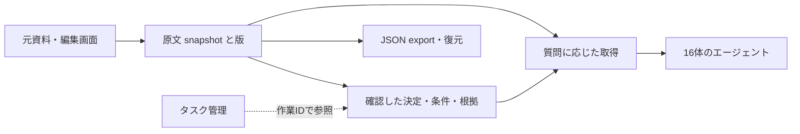

# knowledge-context-lab：Notion移行候補とPhase 4の検証結果

2026-11-05の追加結果：[共有Hubの全文・差分自動選択：16体での比較と再現方法](hub-transfer-evaluation.md)。以下は過去の評価記録です。

2026-11-03。ローカル候補0.7.0rc2。外部公開・本番移行は未実施。前段階の結果は[Phase 3保存版](phase-3-workflow-findings.md)と[Phase 2保存版](phase-2-confirmation-findings.md)に保持する。

## 結論

### 最新：既知topicでは取得方法の改善を採用

**「取得方法だけ改善」まで判断を進めた。** 質問の前に確認した原文範囲を、明示的なtopic・出典・版とともに返し、関連資料の訂正や追加で再確認待ちにする経路を実装した。自由検索やNotion全面移行の採用判断とは分ける。

同じ資料・同じ確認状態の全文方式に対し、参照入力中央値は475.5→382 token（19.7%減）。1万資料の実モデル比較は12意図×3反復で、全文・範囲とも完答/安全な不明回答36/36、実API入力合計は24,801→21,969（11.4%減）だった。100→1万資料で固定topicの入力は増えなかったが、topicを絞った全文でも一定なので、絞り込みの効果をDBや範囲選択の成果に付け替えない。引用ID方式は必須事項を2回答で省き、標準採用しない。

これで既知topic用の改善は具体化した。ただし小さな自作診断での観測であり、誤答確率の統計的低下、自由検索全般の同品質、人手確認込みの総費用削減は未確定。[詳細結果と再現手順](phase-2-reuse-findings.md)／[利用ガイド](reviewed-context-guide.md)。以下はこの判断以前の測定も保存している。

### 前回：回答の揺れを減らす仮説の追加検証

**順序の固定は取得を再現可能にしたが、条件・例外を含む親節の一律追加によって回答品質の揺れが減るとは確認できなかった。** 文献調査→fixture固定→開発選定→最終取得1,620行→同じ入力の実モデル120回答、さらに1万資料で60回答まで測定した。100資料では両方式の必要事実・安全な不明回答が60/60。1万資料でも両方式30/30だったが、親節方式の1回答に根拠にない時期の追加があり、回答全体の支持は従来30/30対親節29/30。親節方式の実入力は1万資料で3.27倍となり、一律採用しない。

これは自作診断であり、1問の権限外goldと2問のcross-documentラベルの欠陥も保存した。この時点の判断は「追加検証が必要」だった。同じ正解文を出すこと、必要事実を保持すること、引用が正確であることは別々に評価する。[仮説・研究・全結果](phase-2-stability-findings.md)／[事前計画](phase-2-stability-protocol.md)。この結果をDBの効果や本番16体の成果とは呼ばない。

### 前回までの資料増加・移行評価

**資料量と入力tokenの追加診断では、大幅に小さい入力は作れたが、同品質の改善とは認められなかった。** 100→1,000→10,000資料の混在条件で、project全文の入力中央値は5,716→55,867→562,645 reference tokens。2,000-token枠で段落を選ぶ候補は737→1,994.5→1,994.5に抑えた一方、固定した最終18問の必要引用を全保持したのは13/18だった。1万資料でproject全文比99.65%減でも、そのまま採用しない。資料100倍で入力増加25%以内という事前目標も未達である。これは**取得方法を改善する余地と、単なる上限設定の限界を分離できた結果**であり、DBの節約効果ではない。

最終18問は9プロジェクト・2種類の質問テンプレートによる自作診断で、3 seedを独立54問とは数えない。さらに1問は「現行方針」に対して過去の設定を必須引用にする評価側の不整合を監査で発見した。raw 13/18を維持し、都合よく除外して成功率を上げていない。残る4問でも必要な事実を取り逃した。token数はinstruction・request・出典/offset/状態付きcontextを`o200k_base`で計数した値で、今回の実モデル回答品質・請求額は未測定。新しいAPI呼出しは0回。

**総合判断は「追加検証が必要」。取得方法の改善に対象を絞り、原文を保つ読み取りmirrorと訂正検査を暫定候補に残す。DBへの全面移行は選ばない。** 許可された実Notionの14ページで、固定した最終6問・12回のAPI比較まで実施した。取得は速くなるが、回答生成を含めた30%改善の目標は未達。同じ品質で総費用と時間を減らすという全体目標には、まだ追加検証が必要である。

**ネットワーク越しの取得も追加実測した。** 認証付きCloudflare検証環境で、既知IDの架空原文を返す処理は、接続再利用時に固定コピー22〜33ms、D1 42〜51ms（資料サイズ別中央値）。408/408回の取得で原文バイトが一致した。ローカル以外でも短時間で原文を供給できることは確認できたが、Notionと同一の資料・client・取得APIによる比較ではないため、Notion比の改善倍率とはしない。実検索・Notionからの同期・回答生成はこの試験に含めない。認証付き一時Worker/D1は試験後に削除済み。GitHub公開・本番移行は未実施。

実務上の価値が確認できたのは、原文を一度だけ取得して再利用すること、版と根拠を保つこと、訂正時に古い決定を止めること。入力tokenの節約はこの同一原文比較では0%。SQLiteはファイルより速いとは言えず、採用理由になるとすれば更新・履歴・競合管理である。人の編集画面を置き換える理由は今回の結果からは得られていない。

公開前のローカル実装として、原文・属性・履歴の保存、根拠付き決定、訂正時の失効、競合の検出、再送、export/restore、CLI/MCPを実装した。SQLiteはこの状態管理を担う候補であり、検索の節約をSQLiteの効果として扱わない。人が編集・確認する画面と、作業の担当・期限・完了を扱うタスク管理は別の役割である。既存の編集画面を残し、エージェントの取得だけ改善する構成も比較対象に残す。



図の決定記録は明示的なtopic参照で取得する。検索から自動で最適な決定記録へ振り分ける機能は未実装。承認者名は信頼されたローカル呼出元の申告であり、本人認証や意味的承認の証明ではない。

**具体的な候補は、原文snapshotを正確に保持し、CLI/MCPで読む構成。** 実資料の非公開コピーで取り込み・取得・訂正・再送・復元を実行し、確認用のローカルworkspaceも保存した。編集画面は現在のものを使える。Notionを残すこと自体は目的ではなく、編集UI・権限・添付を作り直す費用を正当化する効果がまだないためである。

| 構成 | 得られること | 負担・弱点 | 現在の扱い |
| --- | --- | --- | --- |
| Notionをそのまま使い、検索手順だけ改善 | 構築・同期の負担が最小 | 毎回の取得費用、履歴・決定の解釈が残る | 実務比較の基準 |
| 編集画面＋読み取りmirror＋根拠付き決定 | 版・再利用・訂正失効を制御できる | 同期遅延、取り込み範囲の欠落、二重管理の確認が必要 | 実資料のローカル検証済み。取得改善の候補 |
| 独立storeへ全面移行 | 編集・保存・取得の契約を揃えやすい | 編集UI、認証、同期、添付、保守を新たに負担 | 実装の一部あり。全面移行の根拠は未充足 |

外部作成のLongMemEvalを追加し、自作の短い問題への依存を減らした。最初に固定した14問では、全文13/14、BM25で6会話に絞る方式12/14。安くなっても追加の誤答があったため、そのままの一律採用は見送った。その後、集計・合計等の問いを全件取得へ回す改善では、**保存済み応答の再生で13/14を保ち、料金表ベースの推定費用47.54%減**となった。これは既知問題での回帰評価であり、新しい最終評価でも実Notionの移行効果でもない。

全500問の取得評価では、この切替によって必要session全保持が418→460/500へ改善し、入力は全文比47.05%減。ただし40問は根拠を取り逃す。通常検索を「必要情報がすべて揃った証拠」と扱わず、完全性が必要な処理は明示的に`coverage=all`を使う。対象は読み取り権限のあるローカルsnapshotであり、外部世界や未取得のNotionページまで完全という意味ではない。

## 比較表

### 最新：確認済み原文の再利用

| 指標 | 同topicの確認済み全文 | 同topicの確認済み範囲 | 同範囲＋引用ID |
|---|---:|---:|---:|
| 参照入力中央値：100→1万資料 | 475.5→475.5 | 382→382 | 同じ範囲・生成指示は別 |
| 実モデル完答/安全不明 | 36/36 | 36/36 | 34/36 |
| 実API入力合計 | 24,801 | 21,969 | 22,437 |
| 出力token合計（reasoning込み） | 15,917 | 14,162 | 12,162 |
| usage料金推計USD（請求未測定） | 0.010273215 | 0.009277900 | 0.008324700 |
| 本文/範囲からの引用 | 34/36 | 36/36 | 36/36 |

各方式は最終12意図×3反復。同topicの原文を取得し、そのうち確認範囲を選ぶ効果を同じ条件で比較した。実入力11.4%、料金推計9.7%減。全文の引用2件は提供JSONの属性を引用しており、意味的な捏造ではない。ID方式の省略による安さは品質を保った改善としない。[108応答](../runs/phase2-reuse-model-public-v1/results.json)／[集計](../runs/phase2-reuse-model-analysis-public-v1/summary.json)／[意味監査](../runs/phase2-reuse-model-root-review-v1/review.json)

原文範囲の別試験では重複の統合だけで保存済みcontext token合計11.50%減。モデル再生成なし。更新試験は4状態×16並列読み取りで、訂正・追加後にfresh viewが古い内容を返さないことを確認した。1万件のviewを各読者が作り直す場合は16人分で14.73秒、構築済みviewの16取得は合計0.73msであり、準備を除いた数値だけで速さを主張しない。[全比較・前提](phase-2-reuse-findings.md#比較表)

### 安定性：固定入力の反復と資料増加

| 比較指標 | 従来の段落選択 | 順序固定／親節候補 |
| --- | ---: | ---: |
| 最終の入力順不変（108組） | 90/108 | 順序固定108/108 |
| 全言い換え・順序・規模で必要根拠保持 | raw 10/11 | 親節raw 10/11 |
| 100資料：必要事実・安全な不明回答 | 60/60 | 親節60/60 |
| 100資料：引用契約まで満たす回答 | 59/60 | 親節60/60 |
| 1万資料：必要事実・安全な不明回答 | 30/30 | 親節30/30 |
| 1万資料：追加断定も含めて根拠に忠実 | 30/30 | 親節29/30 |
| 1万資料：実input中央値 | 2,464 | 親節8,769.5 |
| 全件要求2問：100→1万のreference中央値 | 1,114.5→84,243.5 | 全方式共通 |

100資料は12問×5回、1万資料は全件要求を除く10問×3回。後者は結果を見た後に追加した探索的検証で、検索やpromptを調整していない。raw 10/11には不可視private資料を必須goldにした評価欠陥1問を含む。これを後から成功へ変更せず、安全な不明回答を別集計した。1万資料の全件要求はモデルへ送っていない。

同じ10問の実input中央値は100→1万で従来906→2,464、親節1,221→8,769.5。文章の完全一致は100資料の両方式とも2/12意図のみだったが、残る表現差を意味誤答とは数えない。原文の重なる節を親節候補が重複して返す実装上の冗長性も判明しており、このtoken差を親節方式全般へ一般化しない。取得集計 (`../runs/phase2-stability-analysis-v1/summary.json`; historical artifact not included in this preview)／100資料API (`../runs/phase2-stability-model-analysis-v1/summary.json`; historical artifact not included in this preview)／1万資料API (`../runs/phase2-stability-scale-model-analysis-v1/summary.json`; historical artifact not included in this preview)

今回の新規生成180回と接続確認1回は完了。追加保守計上0.243414600 USD、累積9.653204350 / 10 USD。不明予約2件は維持。実請求・残高は未測定。

### 資料量と入力token：固定後の最終診断

新fixture v4を改善実装前にhash固定し、開発12問で段階的に比較した後、`diverse_sections`・context上限2,000を固定。未使用の最終18問を3 seed・9条件・8方式、計3,888行で測った。下表は旧版・複製・別条件・無関係資料が増えるmixed条件。同じ質問集合の中央値で、各セル18問×3 seed、計54観測である。

| 方式 | 100資料 | 1,000資料 | 10,000資料 | 10,000資料で必須引用を全保持した問数 |
| --- | ---: | ---: | ---: | ---: |
| 可視資料を全部入力 | 130,697 | 1,106,752 | 10,825,573 | 18/18 |
| 指定projectの全文 | 5,716 | 55,867 | 562,645 | 18/18 |
| 上位6資料の全文 | 5,715 | 6,949 | 6,884 | 10/18 |
| 完全複製を除いて上位6資料 | 4,696 | 6,896 | 6,896 | 12/18 |
| 段落選択・類似段落を後回し | 737 | 1,994.5 | 1,994.5 | 13/18 |

単位は1質問あたりreference input tokens。providerの隠れたmessage framing・出力は含まない。巨大な全文行は必要入力量の算出であり、その量をモデルへ送って成功した実績ではない。全文の18/18は採点対象の引用が入力に存在することだけを示す。

候補のmixed p95は2,039→2,051→2,051。project全文のp95は18,207→83,039→789,005。候補の100→10,000資料での「中央値の比」は2.71倍、同じ質問ごとの比の中央値は1.74倍、最大2.92倍である。この2種類の比を混同しない。25%以内に収まったのは18問中9問で、全条件・全引用保持の採用基準を満たさない。

増加内容も分けた。**無関係なprojectだけが増える条件**では、明示projectフィルターにより対象資料が変わらず、入力も変わらない。これはscope指定の効果。**既存資料が長くなる条件**では、固定100資料の本文総量が193,202→439,532→1,424,852文字（7.38倍）となり、project全文の入力中央値は5,772→16,932→61,572、候補は870.5→2,044→2,041だった。ただし引用全保持は各13/18のままである。生成器の倍率16を実本文量16倍と呼ばない。

**全件回答は別扱い。** 開発用の機材一覧1問では、取りこぼしを避ける全文経路が4,758→56,424→567,838 tokensへ増え、上限超過を明示した。最終18問には全件・履歴・不明回答の問題がなく、この経路の最終品質検証にはなっていない。

!入力tokenと根拠保持の比較 (`../runs/phase2-token-growth-analysis-v2/token-growth.png`; historical artifact not included in this preview)

各改善の寄与も保存した。下表は同じ混在1万資料・最終18問の比較であり、開発での改善を最終の改善へ転記していない。

| 追加した処理 | 入力中央値 | 必須引用を全保持 | 判断 |
| --- | ---: | ---: | --- |
| 上位6資料 | 6,884 | 10/18 | 件数上限だけでは不足 |
| ＋完全複製除去 | 6,896 | 12/18 | token数はほぼ同じで2問回復 |
| ＋段落選択・2,000枠 | 2,028 | 12/18 | さらに小さいが欠落は残る |
| ＋同一段落の重複抑制 | 1,983 | 13/18 | 1問回復 |
| ＋索引作成前の段落重複除去 | 1,983 | 13/18 | 追加改善なし |
| ＋類似段落の後回し | 1,994.5 | 13/18 | 開発では改善、最終では追加改善なし |

開発のpoint問題では最後の処理によって79/81→81/81観測が全保持になったが、最終では351/486観測に留まった。同じ18問の繰り返しから統計的有意差や母集団の同品質を主張しない。最終を見た後の検索調整は実施していない。固定した選択 (`../runs/phase2-token-growth-selection-v1/selection.json`; historical artifact not included in this preview)／最終raw行 (`../runs/phase2-token-growth-final-v1/rows.jsonl`; historical artifact not included in this preview)／分離集計 (`../runs/phase2-token-growth-analysis-v2/summary.json`; historical artifact not included in this preview)／意味・再実行監査 (`../runs/phase2-token-growth-audit-v1/receipt.json`; historical artifact not included in this preview)

既存の実モデル測定も再集計した。以前の別fixtureでは100→10,000資料で、上位6全文の実input平均は1,978→2,095（+5.9%）に留まる一方、正答は38/40→26/40へ悪化。上位12全文は3,372→3,807（+12.9%）、38/40→36/40だった。20問×2反復の保存済み結果で、新しいモデル実行ではない。保存済みusageの再集計 (`../runs/phase2-token-prior-model-growth-v1/summary.json`; historical artifact not included in this preview)

外部LongMemEval 500問の保存済み結果でも、6会話取得は全文比84.43%少ない入力で全必要session保持418/500、全件切替付きは47.05%少なく460/500。各問の全文量は105,281〜114,590 tokensの狭い範囲なので、これは100倍増加の検証とは扱わない。外部データ再集計 (`../runs/phase2-token-external-growth-v1/summary.json`; historical artifact not included in this preview)

### ネットワーク上の取得：同一原文・同一HTTPS入口で保存先を比較

架空JSON 4,211 / 33,238 / 132,755 bytesを測定前に固定。Macの同じPython clientから同じWorkerへHTTPSで接続し、固定コピーとD1主キー検索が同じ本文を返す。D1はAPAC、管理API応答はKIX/primary、read replication無効。各資料・方式は接続再利用12回、新規接続6回、別途16件同時を3巡。順番はseed固定で交互化。v1の後、socket再利用と最大同時数の計測だけを追加したv2を主表とする。

| 返却本文 | コピー：接続再利用 median / p95 | D1：接続再利用 median / p95 | コピー / D1：新規接続median |
| --- | ---: | ---: | ---: |
| 4.2KB | 21.7 / 137.4ms | 42.5 / 115.5ms | 74.3 / 116.2ms |
| 33.2KB | 32.7 / 118.0ms | 42.2 / 108.9ms | 104.5 / 112.0ms |
| 132.8KB | 26.2 / 105.1ms | 51.2 / 84.0ms | 99.0 / 122.4ms |

16件同時の完了時間はコピー194〜212ms、D1 250〜400ms（各3巡、すべて16/16一致）。client最大in-flight16、再利用予定の72/72で同じsocketを確認。v1/v2とも204/204本文・版・no-store一致、不正/未認証の4呼出しを401で拒否。新規接続はserver cacheやDNSの完全coldではなく、p95はn=6/12では最大値。短期間の同一地域観測であり、一般的な遅延保証やD1の優劣の証明ではない。v2生結果 (`../runs/phase2-network-https-v2/summary.json`; historical artifact not included in this preview)／初回結果 (`../runs/phase2-network-https-v1/summary.json`; historical artifact not included in this preview)

D1のmedium原文を期待版付きで1→2→3→4へ更新し、各ack後の16読み取り、合計48/48で新版本文が一致。固定コピーは対照として3/3が旧版1のまま。更新内容は原文JSON内のversionとDB列のversionを同時に変更した。これはD1への更新後取得であり、Notion→mirror同期、継続監視による反映遅延上限、多地域整合性の試験ではない。更新receipt (`../runs/phase2-network-https-v2/update-receipts.json`; historical artifact not included in this preview)／新版4の16読み取り (`../runs/phase2-network-update-v4/summary.json`; historical artifact not included in this preview)

同時間帯の実Notion接続toolでは3ページ×4回、中央値683ms、16件同時1,426ms、28/28成功・繰返し本文一致。本文・実IDは保存せず匿名量のみ。ただしclient所在地・tool overhead・資料が違うので上表との比率を計算しない。別経路の観測 (`../runs/phase2-network-https-v1/notion_context.json`; historical artifact not included in this preview)。追加モデルAPI0回、Cloudflareの実請求額は未測定。Worker/D1の削除後に一覧からの不在を確認した。削除確認 (`../runs/phase2-network-https-v2/cleanup.json`; historical artifact not included in this preview)

### 実Notionの非公開コピー：固定した最終6問の対応比較

必要な14ページ、本文計61,944文字（629〜16,022文字）を公開repoの外へ保存した。開発6問・最終6問を別に固定し、最終設定は回答を見る前に保存。自作の実資料診断であり、独立benchmarkではない。最終は同じ順位付け・上位1ページ・全文captureを両経路に使い、API requestは6/6組で完全一致した。現コードからの入力再生も12/12一致し、検索へ渡したのは通常の質問と可視sourceのみ。goldファイルは再生処理で読んでいない。入力再生監査 (`../runs/phase2-migration-private-pilot-integrity-v1/summary.json`; historical artifact not included in this preview)Notion側は直前の再取得が固定captureと6/6一致することを確認した。Notion固有の検索性能を測ったものではない。

| 指標（各6問） | Notionから再取得 | ローカルfile mirror |
| --- | ---: | ---: |
| 中心的な事実の正確性 | 6/6 | 6/6 |
| 固定goldの全項目を提示した回答 | 4/6 | 5/6 |
| 固定gold項目の保持 | 14/16 | 15/16 |
| 全引用がcapture原文に完全一致 | 4/6 | 4/6 |
| 一致した引用数 | 33/35 | 26/28 |
| 実input tokens | 28,433 | 28,433 |
| 取得時間中央値 | 940ms | 7.32ms |
| 取得時間合計 | 5.834秒 | 0.045秒 |
| API生成時間合計 | 64.679秒 | 71.701秒 |
| 取得＋生成の成分合計 | 70.513秒 | 71.746秒 |
| 料金表による推定USD | 0.005388 | 0.006184 |

同一入力でも出力長とprovider cacheの扱いが異なる。交互順で実施した各1回の診断であり、費用差・生成時間差を保存先の効果とはしない。成分合計にはprocess起動・同期維持・人の確認時間を含まず、実運用agentの一続きの所要時間ではない。今回mirror全体が速く安くなったとは言えない。意味レビューは別agentとrootが全12回答を確認し、引用数はコードで再集計した。固定goldの省略は残したままで、基準を緩めて満点にしていない。匿名集計 (`../runs/phase2-migration-private-pilot-v1/summary.json`; historical artifact not included in this preview)／入力一致・引用・時間・費用の機械監査 (`../runs/phase2-migration-private-pilot-v1/paired-audit.json`; historical artifact not included in this preview)

同じ6問を巡回する16件の読み取りでは、Notion経路1.268秒、file 0.097秒、SQLite 0.106秒で、各16/16が同じ原文を返した。client側の最大in-flightは各16。ただし同じ接続資格を使った呼出しで、16体の個別認証済みagentではない。provider内部の並列度・cache状態は不明。取得部分だけではfileが約92%短縮したが、モデル生成16並列の試験ではない。

14ページのSQLite importは0.029秒、export/restore一致。非公開コピーの制御された訂正では、新版・新hash・capture取得の読戻し、旧版保持、topicの`needs_review`、再送、復元が通った。実Notionを書き換えた同期試験ではない。

開発段階で二重本文の問題を発見した。`raw`には本文と`raw_capture.text`の同じ本文が入り、これを基準にすると短縮効果を過大に見せる。原文を1回だけ渡す`capture`を追加した。開発6問・候補3ページで、正しいnative基準129,203 reference tokensに対して`current`は125,246（3.06%減）。旧raw 246,574からの大差をNotionやDBの節約には数えない。実資料ではBM25上位1件が必要テーマを外す例もあり、一律切替を採用しなかった。

### 実Notionの読み取り経路：内容を保存しない観測

既知4ページを3回ずつ、最大2並列で取得した。12/12成功、tool呼出し時間は373〜650ms、中央値491ms。初回確認1回はこの集計から除いた。本文は再取得8/8で一致したが、短時間の観測に限る。本文の長さは1,425〜16,022 Unicode文字で、自作fixtureの134〜437文字より長い。文字数はtoken数ではない。

全12応答で`truncated`と`unknown_block_count`は省略されていた。省略を「欠落なし」とは扱わない。参照先のページ・DB行・添付実体・コメントはこの観測で再帰取得していない。tool経路のcache状態は不明で、cold HTTP、回答生成、mirrorとの速度差、費用削減を測ったものではない。原文・タイトル・URL・実ページIDは保存せず、匿名の量と時間だけを別run (`../runs/phase2-migration-notion-readonly-v1/summary.json`; historical artifact not included in this preview)に保存した。この追補は配布物0.7.0rc1-v3作成後の観測で、当該archiveには含まれない。

### 日本語の架空Notion：固定した最終8問×4方式

改善前に固定した16ページのうち、共有15ページから取得した。32呼出しすべて成功。本文は134〜437文字と短く、自作の診断であり独立benchmarkではない。最終f6〜f8の採点仕様には原文にない運用項目があるため、原文に支持された事実と条件付き提案の区別をレビューした。移行操作の実行試験とは分ける。

| 方式 | 回答内容 | 本文の逐語引用 | 実input tokens | 推定USD | API latency合計 |
| --- | ---: | ---: | ---: | ---: | ---: |
| raw・既存順位 | 8/8 | 8/8 | 23,013 | 0.006213 | 72.12秒 |
| 同じページ・compact形式 | 8/8 | 7/8 | 19,904 | 0.005937 | 73.38秒 |
| compact・BM25順位 | 8/8 | 8/8 | 19,064 | 0.004605 | 73.26秒 |
| 質問別context | 8/8 | 8/8 | 19,064 | 0.004490 | 69.38秒 |

raw→compactの入力13.51%減は保存先を変えない形式の効果。1回答の2引用で、本文の代わりに属性JSONを引用した。後半2方式の入力は8/8で完全一致し、全件取得へ回る問いがなかった。費用差はcache・出力長・反復の揺れも含むため、coverage改善の証拠にはしない。全32件の逐次batchは289.04秒。原応答 (`../runs/phase2-migration-model-final-v1/results.json`; historical artifact not included in this preview)／意味レビュー (`../runs/phase2-migration-model-final-quality-v1/review.json`; historical artifact not included in this preview)／引用・費用・入力一致監査 (`../runs/phase2-migration-model-final-analysis-v1/summary.json`; historical artifact not included in this preview)

### 実モデル：固定した14問

LongMemEval cleaned Sの7分類から2問ずつ。選択は検索改善前にhash固定した。`gpt-6-luna`、同じprompt/schema、provider reasoning effortは既定。APIは最大2並列、予算予約の残りに応じて1並列へ移行した。16同時APIや本番16体の測定ではない。

| 方式 | 回答適合 | 逐語引用・source ID整合 | 実input tokens合計 | 推定USD | API latency合計 |
| --- | ---: | ---: | ---: | ---: | ---: |
| 全文 | 13/14 | 12/14 | 1,582,719 | 0.201947 | 107.04秒 |
| BM25・6会話全文 | 12/14 | 13/14 | 239,897 | 0.033481 | 85.90秒 |
| 質問による全文/BM25切替 | 13/14 | 14/14 | 保存応答を再利用 | 0.105941 | 99.78秒相当 |

3行目は前2行から同じ入力の保存応答を選び直した**replay**。新規モデル実行0回、独立のend-to-end測定ではない。latency合計は各呼出し時間の和であり、並列batchの経過時間ではない。最初の28呼出し全体は125.34秒だった。索引・取得は別計上し、14問BM25計約0.21秒。請求書、API credit残高・充当先は未測定。

実API使用量 (`../runs/phase2-longmemeval-model-final-v1/rows.json`; historical artifact not included in this preview)／最終意味レビューv2 (`../runs/phase2-longmemeval-model-final-quality-v2/review.json`; historical artifact not included in this preview)／切替replay (`../runs/phase2-longmemeval-coverage-replay-v2/summary.json`; historical artifact not included in this preview)。採点はAIによる原文・公式カテゴリ条件の照合であり、独立人手評価や公式leaderboardの採点モデルではない。引用一致は回答の正しさを保証しない。

### 全500問：取得だけの比較

同じquery、同じ全会話、同じreference tokenizer。文書を削らず、選んだ会話は全turn・role・dateを保持する。goldのsession IDは取得後の採点にだけ使用した。

| 方式 | 全必要session保持 | 必要session recall | 入力reference tokens | 全文比削減 |
| --- | ---: | ---: | ---: | ---: |
| 全文 | 500/500 | 100% | 56,158,408 | 0% |
| 単語一致・6会話 | 367/500 | 80.59% | 9,350,784 | 83.35% |
| 会話単位BM25・6会話 | 418/500 | 88.50% | 8,746,609 | 84.43% |
| 会話単位BM25・12会話 | 454/500 | 93.67% | 16,901,136 | 69.90% |
| 全文/BM25切替 | 460/500 | 94.62% | 29,737,143 | 47.05% |
| turn単位BM25・6会話 | 407/500 | 85.55% | 8,511,260 | 84.84% |
| 全文/turn BM25切替 | 456/500 | 93.46% | 29,605,539 | 47.28% |

turn単位化は悪化し、不採用。候補数増加は根拠保持を改善するが、回答品質を保証しない。全500件で実モデルを実行したわけではない。参照tokenは実課金tokenと分けて表記した。先行21問との49組のsource選択・payload token一致も確認した。500問の数値 (`../runs/phase2-longmemeval-corpus-turn-v1/summary.json`; historical artifact not included in this preview)／再生監査 (`../runs/phase2-longmemeval-corpus-turn-v1/metadata.json`; historical artifact not included in this preview)

### 変更ごとの寄与

| 変更 | 実際の結果 | 判断 |
| --- | --- | --- |
| 短い日本語ページの節分割・履歴除外 | 自作dev8問で平均2,604→2,739 reference tokens。引用の取り違えも発生 | 一律の短縮には使わない |
| 同一取得をfile/SQLiteで比較 | 完全payload 8/8一致、必要section13/13保持 | DB由来のtoken節約はない |
| 単語一致→会話単位BM25 | 外部500問の全根拠保持367→418 | 取得の改善として採用候補 |
| 候補6→12 | devで時間順の逆転回答が出た | 数を増やすだけで安全とはしない |
| 質問に応じて全件取得 | 500問418→460、14問replay追加誤答1→0 | opt-inで実装。新たな実務評価が必要 |
| 自動の回答検証 | 別イベントの誤結合を発見する一方、正しい件数を曖昧に修正した | 一律自動修正は不採用 |
| source版に結びつく決定記録 | 訂正すると旧決定を`needs_review`として保留、履歴参照は可能 | 実装・試験済み。人の訂正時間短縮は未測定 |

自動検証は3版各14呼出しを追加した。v1は引用周辺だけを見て、参照日を情報cutoffと誤解。v2で日付の意味を分けても、引用の前段にある事実を落とした。v3で引用した会話全文を読ませるとその誤判定は消えたが、家具の数え方に余計な条件を入れた。v3追加推定費用0.011773 USD、追加batch63.14秒。実装候補は残すが、正答へ自動上書きする既定処理にはしない。

## 失敗例

最新試験では引用ID方式に「分類追加のレビュー」と「閾値変更の再承認」の省略が1回ずつ出た。引用文字列をコードで正確に返しても回答全体は保証できない。全文方式の2引用は本文外のversion/statusであり、本文引用契約と意味的な支持を分けて扱う。以前のtopic保存経路で、新しい関連資料の追加を失効理由にできない例も再現し、新経路ではsource集合も照合した。[失敗の詳細](phase-2-reuse-findings.md#失敗例)

### 安定性検証で判明した失敗

- 100資料の従来方式で、二つの正しい箇所を途中省略のある一つの連続引用として返した。意味正答でも引用契約に違反する。
- 1万資料の親節方式で「復元ログを保管」を「移行後は復元ログを保管」とし、原文にない時期を追加した。必須語だけの採点では見逃す。
- 非所有者が読めないprivate資料の内容をanswerable goldにしていた。凍結後に発見し、raw得点を維持してerrataへ記録。cross_documentと呼んだ2問も単一資料の複数IDで、実際の複数資料照合は未測定。
- 親節とその内側の節を重ねて返す冗長性が16 payloadにあった。結果は保存し、今回の候補を一律採用する根拠にはしない。

[失敗の原文・計算・監査](phase-2-stability-findings.md#失敗例)。旧mode別audit-v2はcategoryとmodeを混同したため、`phase2-stability-analysis-v1/summary.json`で置き換えた。

token最終診断では「Lumenの現行方針と条件は？」に対し、検索語を含む一般的なレビュー・制約・引き継ぎ段落を返したが、「緊急問い合わせは当番、通常は翌営業日」という核心を落とした。資料IDが正しくても必要な段落があるとは限らない。予算枠や根拠IDだけの検査ではこの失敗を防げない。Mesaの未採用条件、Opalの機材一覧、Quartzの閲覧者も取り逃した。Novaは質問と必須引用の現行/過去不一致があり、採点仕様自体の欠陥としてraw結果と共に保存した。

fixture v1〜v3は、件数・prefix整合・複製project・成長分布の監査を通らず不採用。v4でも文章はテンプレート由来で、最終の質問表現は2種類に限られる。これを独立benchmarkや実Notion全般の品質証明としない。作図の初回はmacOS backendがexit134で停止し、保存済み集計を維持したまま`MPLBACKEND=Agg`で別runに作図した。

ネットワーク試験では、D1だけを更新しても配布済み固定コピーは旧版のままだった。速いコピーを作ることと、新しい決定を届けることは別である。同期・版失効を備えずに固定コピーを最新情報として使ってはならない。CLI準備はnpmのchild process起動が通常実行・昇格後ともEPERMで失敗し、接続済みCloudflare toolを使って測定した。

今回の実資料では、質問の中心に答えていても、固定goldが求めた背景の未確認事項や根拠種別を省く回答があった。またMarkdown escapeの脱落や句読点の変更で4回答の引用が完全一致しなかった。引用が原文の部分文字列でも、複数主張のすべてをその引用だけで支えるとは限らない。自動的に承認済みの決定記録へ昇格させない。

更新試験では、正規captureを残して派生本文だけを変更すると、取得形式によって新旧が分裂する問題を発見した。正規Notion captureから導出する本文・属性・ID・時刻・参照一覧の整合性をimport時に検査し、不一致を拒否するよう修正した。訂正はcaptureの本文範囲を更新して再変換し、DBとcapture取得から実読戻しした。初期の自己参照だけの検査も残し、修正版を別runで実行した。

1. **全体の数を上位検索だけで数えた。** 4品の家具のうち購入したマットレスが抜け、3品と回答。goldの必要session4件中2件保持という指標と、回答の4品中3品を混同しない。
2. **引用が正しくても別の出来事を結合した。** 「最初の研究会」「ポスター発表」「大学名」を同一イベントと推測し、本来不明の大学を断定。全文でも発生した。
3. **引用だけの検証が正しい事実を疑った。** Denverのコンサート会場は同じ会話の冒頭に明記されていたが、引用周辺だけでは見えなかった。検証者にも必要な原文が要る。
4. **検証者が新しい条件を作った。** 家具の集計に配送完了やカテゴリ定義の条件を持ち込み、元の4品という答えを3品へ修正。検証モデルも最終的な正解装置ではない。
5. **資料の日付の意味が曖昧。** 外部500問中76問は質問の時刻より同日の会話時刻が後だった。翌日以降は0問。参照日と、その時点までに入手できた情報のcutoffを分ける必要がある。日付監査 (`../runs/phase2-longmemeval-date-audit-v1/summary.json`; historical artifact not included in this preview)
6. **評価側の誤りも保存して修正した。** 初回レビューは引用一致を意味正答に近づけすぎ、preferenceの公式基準を過剰に厳格化した。v3へ訂正。全500評価v1はsourceだけのtokenで、現在の表はrequest込みへ統一した。v2は資料中の特殊token文字列で失敗し、通常の文字列として数えるv3へ修正した。旧runは保持。

## 再現方法

最新の固定入力は`fixtures/phase2-reuse-v1/`、方式選択は`runs/phase2-reuse-selection-v1/selection.json`。`scripts/evaluate_reuse.py`で100/1,000/10,000件を再現し、`scripts/analyze_reuse_model.py`は保存応答を追加API費用なしで再集計する。`scripts/demo_reviewed_context.py`は一時DBで登録→確認→取得→訂正失効を動かす。[具体的なコマンド](phase-2-reuse-findings.md#再現方法)。本体と配布の確認は[最新検証receipt](../runs/phase2-reuse-validation-v1/receipt.json)。既存の最終問題は今後回帰用とし、元runを上書きしない。

### 安定性の新しい再現入口

`fixtures/phase2-stability-v3/`と`runs/phase2-stability-selection-v1/selection.json`でfixture・実装を固定。`scripts/evaluate_stability.py`で取得を再現し、`scripts/analyze_stability.py`と`scripts/analyze_stability_model.py`で保存済み結果を再集計できる。[実行コマンド](phase-2-stability-findings.md#再現方法)。後者は有料生成を伴わない。新しい出力名を指定し、既存runを上書きしない。

Python 3.11/3.13で各298 tests PASS、Phase 1保護hashと初期Phase 2固定hashも一致。既存rc2 archiveは今回再生成しておらず、新実装は実験moduleとして保存した。公開・本番変更はない。検証receipt (`../runs/phase2-stability-validation-v1/receipt.json`; historical artifact not included in this preview)

Python 3.11以上。既存の保護fixture/runは上書きしない。

token診断の[事前protocol](phase-2-token-growth-protocol.md)・[fixture](../fixtures/phase2-token-growth-v4/README.md)・`ContextRequest`/`ContextIndex`を追加した。requestはtext/project/mode/actorのみで、問題ID・gold・必須引用を検索へ渡さない。既存CLIの既定方式は切り替えていない。新実装を含むPython 3.11/3.13の全282テストと保護fixture hash検査が通過。検証receipt (`../runs/phase2-token-growth-validation-v1/tests.json`; historical artifact not included in this preview)

```bash
export TIKTOKEN_CACHE_DIR="$PWD/tokenizer-cache"
.venv/bin/python scripts/evaluate_token_growth.py \
  --split final --seeds 20261103,20261104,20261105 \
  --selection runs/phase2-token-growth-selection-v1/selection.json \
  --output runs/phase2-token-growth-final-reproduction-new
.venv/bin/python scripts/summarize_token_growth.py \
  --run runs/phase2-token-growth-final-reproduction-new \
  --development runs/phase2-token-growth-dev-v4 \
  --candidate diverse_sections_2000 --no-plot \
  --output runs/phase2-token-growth-analysis-reproduction-new
```

表だけの再集計はtokens以外の追加依存なし。PNG/SVGは任意のmatplotlibが必要（今回3.11.2）；`--no-plot`を外し`MPLBACKEND=Agg`で実行する。再実行した最終問題は以後回帰用であり、新しい未使用評価ではない。既存rc2-v4配布物には今回の追加コード・測定は含まれない。

ネットワーク追加試験の固定入力・認証付きhandler・測定client・一時資源の作成/削除手順はHTTPS検証手順 (`../experiments/network_probe/README.md`; historical artifact not included in this preview)。Node handler 6テストと実HTTPS取得・更新読戻しを実行した。既存Python本体には変更なし。この追加試験は配布済みrc2-v4 archive作成後であり、そのarchiveには未収録。

```bash
python3 -m venv .venv
.venv/bin/python -m pip install -e '.[tokens]'
.venv/bin/python scripts/demo_workspace.py --workdir work/workspace-demo-new
.venv/bin/python -m unittest discover -s tests
```

Python 3.11/3.13の各274件、保護fixtureのhashを確認済み。CLI/MCPのcaptureを新規wheelで実行した。HTMLは構文・内部リンクを検査したが、ブラウザのmacOS/OpenSSL起動エラーにより描画・スマホ実表示は未確認。コード検証 (`../runs/phase2-migration-observation-validation-v3/python313.json`; historical artifact not included in this preview)／HTML検査 (`../runs/phase2-migration-html-audit-v5/summary.json`; historical artifact not included in this preview)

非公開pilotの再現手順は[利用ガイド](workspace-guide.md#private-authorized-pilot)。`evaluate_workspace_pilot.py`は許可済み入力・出力が公開repo外であることを検査し、file/SQLite一致、16読み取り、訂正・再送・復元を測る。`run_workspace_pilot_model.py`は固定hashと既存予算ledgerを要求する。`audit_workspace_model_results.py`は回答・source名・実IDを除いた数値だけを出す。実資料そのものは公開配布しないため、第三者による同じ私的問答の再現はできない。代わりに架空fixtureと外部評価手順を同梱する。

[利用ガイド](workspace-guide.md)に、CLI/MCP、import→根拠付きtopic→訂正→失効→export/restoreの操作を記載した。引用offsetは原文から計算し、動作する架空例を同梱する。16同時更新では同じ期待版から1件がcommitし15件が競合となり、黙った上書きを防いだ。16同時readもローカルで実行済みである。

外部データは[公式LongMemEval](https://github.com/xiaowu0162/LongMemEval)のcleaned Sをignored `work/longmemeval/`へ取得する。公開packageには本文・API応答を含めず、選択manifest・hash・評価コード・集計を含める。原本SHA-256は`d6f21ea9d60a0d56f34a05b609c79c88a451d2ae03597821ea3d5a9678c3a442`。

```bash
.venv/bin/python scripts/prepare_longmemeval.py \
  --source work/longmemeval/longmemeval_s_cleaned.json \
  --output work/longmemeval-prepared-new
# 作成されたprepared-v1を--dataで指定して、別名runへ取得評価する
.venv/bin/python scripts/evaluate_history.py \
  --data work/longmemeval-prepared-new/prepared-v1 \
  --methods full overlap bm25 --split dev \
  --output runs/phase2-longmemeval-reproduction-new
```

7分類をhash順でdev1・final2問ずつ選ぶ手順は固定manifestと同じ。goldは別ファイルで、検索/modelにはrequestと資料だけを渡す。API実行は`run_history_model.py`を使い、既存の費用ledgerを指定する。新ledgerによる予算リセットや、使用量不明試行の自動再実行は行わない。API keyはチャット・repo・公開artifactへ含めない。

## 未検証事項

最新の原文範囲方式では、自由文からのtopic特定、同topic自身の大量増加、人手確認時間、16体の実業務での削減、Notion同期、D1上の新経路は未測定。最終12意図はcurrent modeのみ。履歴・提案・未確認はdevや更新/単体試験の範囲であり、最終実モデル成績に含めない。scope変更は拒否され、権限取消の実装成功とは呼ばない。言い回しの揺れは残り、母集団での正答率向上を証明したわけではない。

今回の180回答は自作問題の反復であり、外部benchmarkや実Notion・16体の本番品質への一般化は未検証。1万資料の全件生成、真の複数資料照合、意味検索、temperature/seed操作、多数決による回答選択、親節の重なり除去後の回答品質は未検証。少数反復で誤りがなくても将来の誤答確率ゼロとは言わない。

- 新token候補の実モデル回答・実usage/課金・16体の運用総token、取り込み/要約/索引作成費用の償却。今回のreference tokensはオンライン請求値ではない。最終18問に含まれない全件・履歴・不明回答、一般的な日本語表現への頑健性。入力を小さく保ったことと、同品質を保ったことは別々に検証する。
- 同じ実資料での取得・生成の対応比較は実施済み。日常の質問分布、同期を含む総費用・待ち時間・人の訂正時間・長期の維持負担は未測定。私的原文は公開repoの外に保管している。
- 日本語の実テーマでの最新決定の網羅性。今回の6問で母集団の同品質を証明したわけではない。外部英語会話の成績をそのまま一般化しない。
- 新しい未使用問題でのcoverage方式と検証方式の回答品質。14問は現在、開発に使用済みの回帰データ。
- 元の500問を含む外部bench全体の実モデル回答精度。公式benchmarkには合成・編集された履歴が含まれ、実Notionの代用にはならない。
- 個別認証された遠隔16体、本番のサービス稼働率、D1へのworkspace全機能移植、複数client所在地、添付ファイル実体・コメント・権限継承を含む完全移行。D1の最小取得・更新読戻しだけは追加実測済み。network probeは同じBearerを共有する16clientであり、個別権限の証明ではない。
- Notionと同一原文・同一client・同一transportでのネットワーク比較、Notion編集からmirror反映までの同期と失効、費用込みの維持負担。最小の既知ID取得を検索付きサービス全体の速さに一般化しない。
- DBと同等のCAS・履歴管理を実装したfile backendとの更新性能比較。SQLiteの優位を確定していない。
- 実請求・credit残高、初期移行や維持管理の人件費。共通10 USD枠の保守的計上は9.409789750 USDで、既存の使用量不明予約2件・0.6008792 USDを含む。非公開pilotでは15試行中14成功、1件は出力上限2048によるJSON未完了。使用量確定で計上し、4096への変更を別実験に保存した。未知予約の解除・旧失敗試行の再送・予算リセットはしていない。

## 次の判断

既知topicの読み取りには、確認済み原文範囲と訂正/追加時の失効を選択可能な経路として採用する。引用ID方式は標準にしない。DB全面移行は進めず、自由検索は既存経路を残す。次に適用範囲を広げるなら、自由文のtopic特定または同topic内の増加を別の新しい問題で測り、確認工数を加える。今回の追加保守計上0.072912675 USD、累計9.726117025/10 USDで、過去の未確定予約は維持した。公開・本番変更なし。

以下は以前からの判断軸であり、重複範囲の除去と確認済み原文の再利用については上記で今回測定した。

安定性の検証からは、順序固定を取得の再現性のために残し、親節の一律追加は採用しない。当時の次候補は重なる原文の除去だった。再利用の仮説は、確認した決定・条件・出典・版を再利用して同じ解釈を繰り返す回数を減らすことと、全件集計を保存側で計算して範囲・根拠付きで渡すこと。既存の訂正失効機能を使えるが、節約と品質は別試験で測る。引用文字列の原文offsetからの生成または完全一致検査も、拒否・再取得の負担を含めて評価する。

token対策の判断は、**上限付き段落検索を一律採用しない。原文と版を保持し、必要な範囲を取得・追加取得できる構成を検証対象に残す。** ファイルからDBへ移すだけでは同じ入力のtoken数は変わらない。次の改善候補は、(1)問い合わせの言い換えを拾う検索、(2)条件・例外・関連する別資料までの追加取得、(3)一覧/件数は構造化した集計として返す経路。これらの有効性は今回の測定からは未確定である。実装前に意味の整合した別問題を固定し、追加取得まで含む総入力と回答品質で全文基準に対する非劣性を検証する。今回の失敗問を見て調整した結果を新しい最終成績とは呼ばない。

ネットワーク取得の最小経路も実用候補に残せる。ただし既知ID取得から検索付きworkspace全体へ進めるには、同じ原文・同じ問い合わせ・同じclient経路で比較し、Notion側の訂正検知→取り込み→派生決定失効→再取得までを測る必要がある。固定コピーの速さだけで自動同期や大規模検索の品質を満たしたことにしない。

移行候補として残すのは、(1)元資料と過去版を失わない、(2)決定・条件・承認の根拠を明示する、(3)資料の変更で古い決定を失効させる、(4)普通の探索と全件確認を分ける、(5)タスクの完了を知識から推測しない、という構成である。検索だけで完全性を保証する方式や、AIの検証結果で無条件に正答を書き換える方式は採用しない。

非公開コピーの許可は解消済みで、同一資料の比較とローカルworkspace作成まで進めた。今回の結果から全面移行を進める理由はない。読み取りの待ち時間が問題になる利用に限ってmirrorを候補にし、ファイル保管を基準に残す。SQLiteを選ぶ場合は、節約ではなく更新の競合・履歴・訂正失効が必要かで決める。

次に大きな改善を判断する対象は、16体が同じ調査を繰り返す頻度と、確認済み決定を再利用して省ける作業量である。ユーザーによると質問・取得履歴の場所は不明、または未存在。既存履歴があると仮定せず、任意のローカル観測機能を追加した。質問・原文・actor名を保存せず、digest・取得時間・結果件数・成功/失敗を記録する。検証用と日常利用を別集計し、同じ取得が繰り返された件数を、そのまま実測の費用節約とは呼ばない。実資料コピー上で16読み取り×2巡と意図した失敗1件を実行し、33件の検証用イベント、原文・質問・actor名の非保存、版変更の分離を確認した。この計測器が記録した日常利用は0件である。観測対象はこのWorkspaceのsearch/context経由だけで、直接Notionや他のツールを使った作業は含まない。16体の実際の利用が0という意味ではない。同じagent内の再取得と、異なるactor間の同一取得を別集計する。実資料診断は同じlocal actorであり、16体の実agentではない。架空共有資料では16 actorの一致と、訂正による別group化を確認した。観測機能の診断 (`../runs/phase2-migration-observation-pilot-v2/summary.json`; historical artifact not included in this preview)日常の件数・同じ質問の再来・資料更新頻度・確認時間を観測し、再利用による削減が構築・同期・確認費用を上回るかを測る。架空の高い再利用率を仮定して勝ちとしない。公開・本番切替は行っていない。ローカルOSS候補としての価値は、原文と決定を分けた更新契約、CLI/MCP、同一入力比較と失敗を再現できることにあり、「あらゆる記憶方式より安い」という主張ではない。
